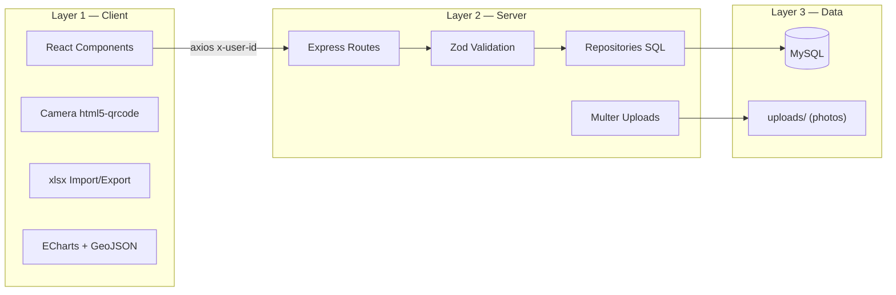

# BundleSystem — Architecture and Resources

## Architecture type: **Multi-tier (3 layers) — Client/Server**

```
┌─────────────┐   HTTP/JSON    ┌──────────────┐   SQL    ┌─────────┐
│  FRONTEND   │ ◄────────────► │   BACKEND    │ ◄──────► │  MySQL  │
│ React+Vite  │  REST API      │ Express/Node │          │    DB   │
│ (Layer 1)   │  x-user-id     │ (Layer 2)    │          │(Layer 3)│
│ :5173       │                │ :3000        │          │ :3306   │
└─────────────┘                └──────────────┘          └─────────┘
     ↑                              ↑
 Camera/barcode scanner        /uploads (photos)
```

It is **multi-tier**: presentation → business logic → data. It is also a classic client/server setup: the frontend knows no SQL — it only consumes the backend's REST API.

- **Layer 1 (Presentation):** React SPA served by Vite — all UI, navigation, form validation and chart rendering.
- **Layer 2 (Application/Logic):** REST API in Express — authentication, business rules, role control, transactions, audit record generation.
- **Layer 3 (Data):** MySQL — persistence of users, inventory, stores, deliveries and history.

---

## Backend Resources (`backend/`)

| Resource | Role in the project |
|---|---|
| **Express** | HTTP server and routing for the whole REST API (`src/routes/`) |
| **mysql2/promise + pool** | MySQL connection with a connection pool; direct SQL without ORM in `repositories/` |
| **Zod** | Validation of request bodies/params (`src/schemas/`) |
| **bcrypt** | Password hashing on login and user creation |
| **Multer** | Photo uploads (clients on deliveries, profile pictures) to `/uploads` |
| **dotenv** | DB credentials and configuration in `.env` |
| **Active-user middleware** | Checks `x-user-id` on every request → 403 if the account is inactive (expires open sessions) |
| **`/uploads` (static)** | Storage and serving of images (client and profile photos) |

### Backend internal layers

```
routes/        HTTP endpoints + Zod validation
controllers/   req/res handling and HTTP errors
repositories/  SQL queries to the DB
middlewares/   validation, image upload, active user check
schemas/       Zod schemas per entity
```

---

## Frontend Resources (`frontend/`)

| Resource | Role in the project |
|---|---|
| **React + Vite** | SPA with hot-reload; one component per page/form |
| **Axios + interceptors** | API calls; automatically sends `x-user-id` and logs out on 403 for inactive accounts |
| **AuthContext + localStorage** | Persisted session (user object) and access control by profile level |
| **ECharts** | Reports dashboard: donut, bar, line charts and **Bolivia choropleth map** |
| **GeoJSON (`/public`)** | Polygons of the 9 departments for the ECharts `bolivia` map |
| **html5-qrcode** | **CODE_128** barcode scanner using the camera (serials, IMEI, MI ID) |
| **JsBarcode** | Generates the CODE_128 barcode with the user's MI ID ("Mi Código" modal) |
| **xlsx / xlsx-js-style** | Reads bulk-import Excel files and downloads styled templates |
| **JSZip** | Internal `.xlsx` editing to insert dropdown lists (data validation) into the templates |
| **Inline CSS + SVG props** | Visual system: blue gradients, cards, confirmation modals, icons |

### Roles and access control

| Level | Implementation |
|---|---|
| Office Manager | `canAccessManagement` → all management pages |
| City Manager | `canAccessBundles` → own bundles + team via `head_in_charge` |
| Field Force | `canAccessDelivery` → Delivery, Share and Receive Bundles |

---

## Database (MySQL)

| Table | Role |
|---|---|
| `user` | Accounts: `mi_id`, email, `password_hash`, `level_user`, `status`, `failed_attempts`, `locked_until` |
| `user_profile` | Personal data: first name, last name, role title, date of birth, city, `head_in_charge`, `profile_picture` |
| `stores` | Stores with code, name, city and owner (`user_id`) |
| `project` | Projects the bundles belong to |
| `bundle` | Bundle inventory: serial, owner, status |
| `bundle_model` + `bundle_color` | Model and color catalog |
| `smartphones_database` + `smartphone_model` | Smartphone inventory by IMEI and model catalog |
| `distributor` | Smartphone distributors |
| `transfer_history` | **Transfer audit**: `bundle_id`, `old_user_id`, `new_user_id`, `manager_user_id` (who made the change), `status` (`transfering`/`completed`/`rejected`/`canceled`) |
| `bundle_delivered` | Delivery records: client, phone, photo, store, date |

---

## Implemented security

- Passwords hashed with **bcrypt**
- **Account lockout** after 5 failed attempts until the next day (`locked_until`)
- Inactive users: login rejected + all requests with `x-user-id` rejected
- Role-scoped data: Office Manager sees everything; City Manager sees their team; Field Force sees only their own

## Resources diagram


