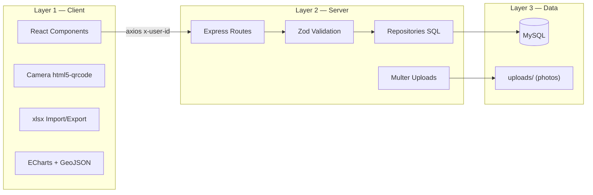

# BundleSystem — Architecture and Resources

## Architecture type: **Multi-tier (3 layers) — Client/Server**

```
┌─────────────┐   HTTP/JSON    ┌──────────────┐   SQL    ┌─────────┐
│  FRONTEND   │ ◄────────────► │   BACKEND    │ ◄──────► │  MySQL  │
│ React+Vite  │  REST API      │ Express/Node │          │    DB   │
│ (Layer 1)   │  x-user-id     │ (Layer 2)    │          │(Layer 3)│
│ :5173       │                │ :3000        │          │ :3306   │
└─────────────┘                └──────────────┘          └─────────┘
     ↑                              ↑
 Camera/barcode scanner        /uploads (photos)
```

It is **multi-tier**: presentation → business logic → data. It is also a classic client/server setup: the frontend knows no SQL — it only consumes the backend's REST API.

- **Layer 1 (Presentation):** React SPA served by Vite — all UI, navigation, form validation and chart rendering.
- **Layer 2 (Application/Logic):** REST API in Express — authentication, business rules, role control, transactions, audit record generation.
- **Layer 3 (Data):** MySQL — persistence of users, inventory, stores, deliveries and history.

---

## Backend Resources (`backend/`)

| Resource | Role in the project |
|---|---|
| **Express** | HTTP server and routing for the whole REST API (`src/routes/`) |
| **mysql2/promise + pool** | MySQL connection with a connection pool; direct SQL without ORM in `repositories/` |
| **Zod** | Validation of request bodies/params (`src/schemas/`) |
| **bcrypt** | Password hashing on login and user creation |
| **Multer** | Photo uploads (clients on deliveries, profile pictures) to `/uploads` |
| **dotenv** | DB credentials and configuration in `.env` |
| **Active-user middleware** | Checks `x-user-id` on every request → 403 if the account is inactive (expires open sessions) |
| **`/uploads` (static)** | Storage and serving of images (client and profile photos) |

### Backend internal layers

```
routes/        HTTP endpoints + Zod validation
controllers/   req/res handling and HTTP errors
repositories/  SQL queries to the DB
middlewares/   validation, image upload, active user check
schemas/       Zod schemas per entity
```

---

## Frontend Resources (`frontend/`)

| Resource | Role in the project |
|---|---|
| **React + Vite** | SPA with hot-reload; one component per page/form |
| **Axios + interceptors** | API calls; automatically sends `x-user-id` and logs out on 403 for inactive accounts |
| **AuthContext + localStorage** | Persisted session (user object) and access control by profile level |
| **ECharts** | Reports dashboard: donut, bar, line charts and **Bolivia choropleth map** |
| **GeoJSON (`/public`)** | Polygons of the 9 departments for the ECharts `bolivia` map |
| **html5-qrcode** | **CODE_128** barcode scanner using the camera (serials, IMEI, MI ID) |
| **JsBarcode** | Generates the CODE_128 barcode with the user's MI ID ("Mi Código" modal) |
| **xlsx / xlsx-js-style** | Reads bulk-import Excel files and downloads styled templates |
| **JSZip** | Internal `.xlsx` editing to insert dropdown lists (data validation) into the templates |
| **Inline CSS + SVG props** | Visual system: blue gradients, cards, confirmation modals, icons |

### Roles and access control

| Level | Implementation |
|---|---|
| Office Manager | `canAccessManagement` → all management pages |
| City Manager | `canAccessBundles` → own bundles + team via `head_in_charge` |
| Field Force | `canAccessDelivery` → Delivery, Share and Receive Bundles |

---

## Database (MySQL)

| Table | Role |
|---|---|
| `user` | Accounts: `mi_id`, email, `password_hash`, `level_user`, `status`, `failed_attempts`, `locked_until` |
| `user_profile` | Personal data: first name, last name, role title, date of birth, city, `head_in_charge`, `profile_picture` |
| `stores` | Stores with code, name, city and owner (`user_id`) |
| `project` | Projects the bundles belong to |
| `bundle` | Bundle inventory: serial, owner, status |
| `bundle_model` + `bundle_color` | Model and color catalog |
| `smartphones_database` + `smartphone_model` | Smartphone inventory by IMEI and model catalog |
| `distributor` | Smartphone distributors |
| `transfer_history` | **Transfer audit**: `bundle_id`, `old_user_id`, `new_user_id`, `manager_user_id` (who made the change), `status` (`transfering`/`completed`/`rejected`/`canceled`) |
| `bundle_delivered` | Delivery records: client, phone, photo, store, date |

---

## Implemented security

- Passwords hashed with **bcrypt**
- **Account lockout** after 5 failed attempts until the next day (`locked_until`)
- Inactive users: login rejected + all requests with `x-user-id` rejected
- Role-scoped data: Office Manager sees everything; City Manager sees their team; Field Force sees only their own

---

## Data at Rest

### Where the data resides

| Location | Data | Protection |
|---|---|---|
| **MySQL (tables)** | Users, bundles, smartphones, stores, deliveries, `transfer_history` | Passwords with **bcrypt hash** (never plain text); connection pool with credentials in `.env` |
| **`/uploads` (disk)** | Delivery client photos and profile pictures | Random names generated by Multer (`uuid`); served as static files only |
| **`.env`** | DB credentials | Excluded from the repository by `.gitignore`; never in code |
| **localStorage (browser)** | Session `user` object | Profile data only — the password hash **never** travels to the frontend |

### Data lifecycle at rest

```
1. CAPTURE    → Form/API validates the data with Zod
2. WRITE      → INSERT/UPDATE SQL inside a transaction
                (e.g. approving a transfer: UPDATE bundle + UPDATE transfer_history
                 together — if one fails, both roll back)
3. AT REST    → Data persists in MySQL/uploads with referential integrity
                (foreign keys: bundle→user, delivered→store, transfer_history→bundle)
4. READ       → Only leaves through the API, filtered by profile-level scope
                (Field Force only reads their own data, never direct DB access)
5. AUDIT      → Data is NOT deleted: transfer_history keeps the full history
                (transfering/completed/rejected/canceled); only base records
                (users, stores, models) can be deleted
```

### Key at-rest security points

- **Nothing critical in plain text**: password = bcrypt; MI ID and emails are stored legibly (the business needs them)
- **Integrity**: foreign keys in `schema.sql` guarantee no orphaned records
- **Immutable audit**: every owner change stays in `transfer_history` with `manager_user_id` — you always know who moved what
- **Indirect access**: nobody touches the DB directly; everything goes through the authenticated API

---

## Data on the Wire

### What travels over the network

| Channel | Data | Format |
|---|---|---|
| **Browser → API** (`:5173 → :3000`) | Login credentials, forms, filters | JSON over HTTP |
| **API → Browser** | Lists, KPIs, deliveries, pending transfers | JSON |
| **Browser → API** | Delivery and profile photos | `multipart/form-data` (Multer) |
| **Every request** | Identity of who performs the action | `x-user-id` header |
| **Backend → MySQL** | Queries and transactions | MySQL protocol (connection pool) |
| **Browser ← /uploads** | Stored images | Static GET |

### Security in transit

- **Development**: plain HTTP on localhost (acceptable locally)
- **Production (recommended)**: **HTTPS/TLS** on the server to encrypt credentials, `x-user-id` and photos in transit; CORS restricted to the frontend domain
- The Axios interceptor adds `x-user-id` automatically — the frontend never "signs" anything; the backend validates the user on every request (active-user middleware)
- The password only travels at login; the frontend never receives or stores the hash

---

## Data State

Each entity has a state machine governing its lifecycle:

### Bundle (`bundle.status`)
```
available ──(delivery registered)──► delivered
   │
   └──(transfer in progress: the bundle status does NOT change,
       only a pending record exists in transfer_history)
```

### Transfer (`transfer_history.status`)
```
transfering ──(recipient approves)──► completed  → bundle.user_id = new_user_id
           ──(recipient rejects)───► rejected   → bundle stays with sender
           ──(sender cancels)──────► canceled   → bundle stays with sender
```
→ This is the only "multi-step transactional" flow: the `transfering` state
blocks a new transfer of the same bundle until it is resolved.

### Smartphone (`smartphones_database.status`)
```
available ──(delivery with verified IMEI)──► delivered
```

### User (`user.status` + `failed_attempts` + `locked_until`)
```
active ──(5 failed logins)────► locked_until = tomorrow 00:00
active ──(admin deactivates)──► inactive → login and all APIs blocked (403)
inactive ──(admin reactivates)► active
```

### Store (`stores.user_id`)
```
assigned to Office Manager (on creation)
   ──(manual assignment or Excel)──► different owner user
```

### Transactions that guarantee state consistency

- **Approve transfer**: `UPDATE bundle` + `UPDATE transfer_history` in a single transaction — never left half-done
- **Register delivery**: `INSERT bundle_delivered` + `UPDATE bundle` + `UPDATE smartphones_database` atomically
- **Direct assignment (Office Manager)**: `UPDATE bundle` + `INSERT transfer_history completed` atomically

## Resources diagram


