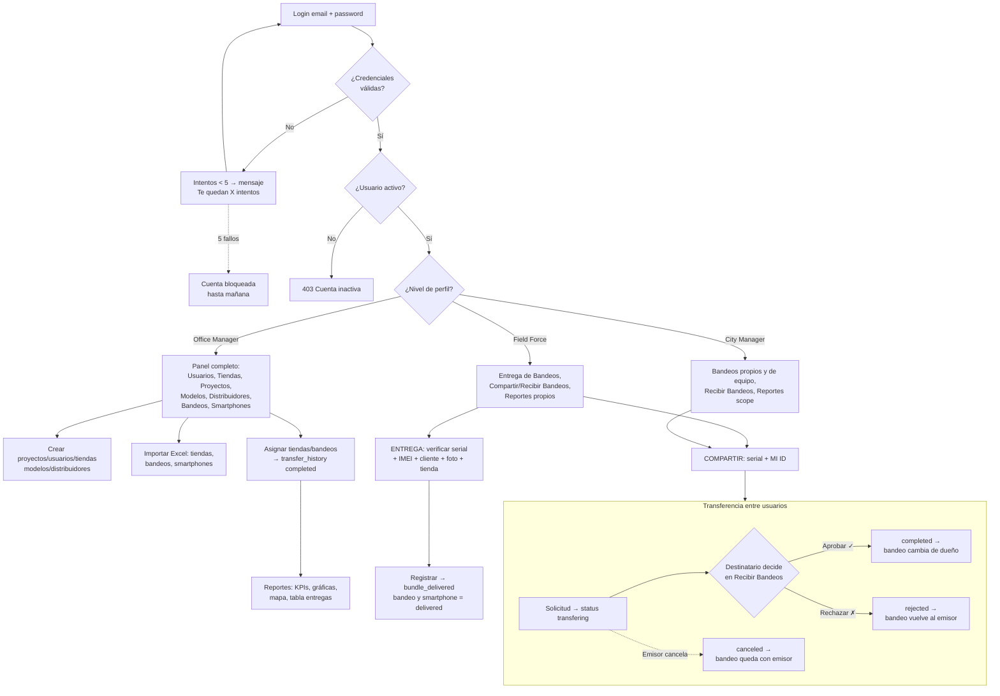
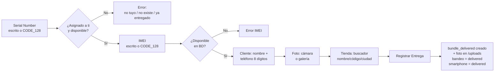
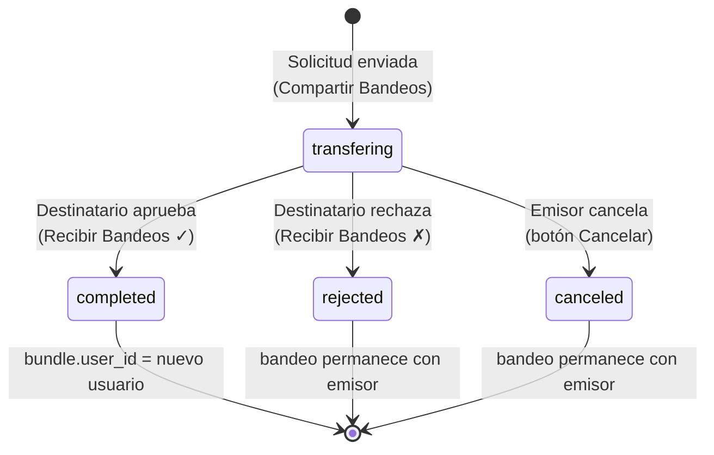

# BundleSystem — Workflow de Usuario

Guía de uso del sistema por rol y proceso, con entradas (inputs) y salidas (outputs) de cada flujo.

## Diagrama de Flujo General



## Diagrama de Entrega de Bandeo



## Diagrama de Estados de Transferencia




## Roles

| Nivel | Acceso principal |
|---|---|
| **Office Manager** | Todo: usuarios, tiendas, proyectos, modelos, distribuidores, bandeos, smartphones, reportes |
| **City Manager** | Bandeos propios y de su equipo, recepción de transferencias, reportes filtrados |
| **Field Force** | Entrega de bandeos, compartir/recibir bandeos, reportes propios |

---

## 1. Autenticación

**Flujo:** Login → validación → sesión activa

| Paso | Input | Output |
|---|---|---|
| Ingresar credenciales | Email + contraseña | Sesión iniciada / error |
| Fallar contraseña | Credenciales incorrectas | "Te quedan X intentos" |
| 5 fallos | — | Cuenta bloqueada hasta mañana 00:00 |
| Usuario inactivo | Cualquier petición | 403 → sesión cerrada |

---

## 2. Flujos Office Manager

### 2.1 Crear Proyecto (Proyectos → Crear Proyecto)
- **Input:** `project_name`, `start_date`, `status`
- **Output:** Proyecto en tabla / mensaje de éxito

### 2.2 Crear/Editar Usuario (Usuarios → Crear Usuario)
- **Input:** `mi_id`, `email`, `contraseña`, `nivel`, nombre/apellido, cargo, fecha nacimiento, ciudad, jefe a cargo, foto
- **Output:** Usuario en tabla con foto circular, badge estado (verde/rojo)
- **Extra:** Eliminar desde el formulario de edición (modal de confirmación)

### 2.3 Crear Tienda (Tiendas → Crear Una Tienda)
- **Input:** `store_code`, `store_name`, `city`
- **Output:** Tienda asignada automáticamente al usuario de sesión

### 2.4 Asignar Tienda (Tiendas → ícono asignar)
- **Input:** Búsqueda de usuario (nombre/MI ID/email) → selección
- **Output:** `stores.user_id` actualizado + confirmación

### 2.5 Importar Tiendas Excel (Tiendas → Crear Tienda desde Excel)
- **Input:** Excel con columnas `Código, Nombre, MI ID, Ciudad`
- **Output:** Tiendas creadas asignadas por MI ID; reporte por fila de errores

### 2.6 Reasignar Tiendas Excel (Tiendas → Reasignar Tienda desde Excel)
- **Input:** Excel con `Código, MI ID`
- **Output:** `stores.user_id` reasignados masivamente; errores por fila

### 2.7 Crear Modelo de Bandeo / Smartphone / Distribuidor
- **Input:** Formularios con los campos de cada tabla (`bundle_name`; `product_id, model_name, sku_name, ram, rom, color`; `distributor_name`)
- **Output:** Registro en su tabla de listados

### 2.8 Crear/Importar Bandeo (Bandeos → Agregar Bandeo / Importar desde Excel)
- **Input manual:** `serial_number`, `project`, `bundle_model`
- **Input Excel:** `Número de Serie, Proyecto, Modelo de Bandeo` (plantilla con desplegables)
- **Output:** Bandeos `available` asignados automáticamente al usuario que importa

### 2.9 Importar Smartphones (Smartphones → Importar Excel)
- **Input:** Excel con `IMEI 1, Product ID, Distribuidor` (plantilla con desplegables)
- **Output:** Smartphones `available`; `tag_model` = 8 primeros dígitos del IMEI; errores por fila

### 2.10 Asignar Bandeo directo (Bandeos → ícono asignar)
- **Input:** Serial verificado + usuario destino (buscador)
- **Output:** `bundle.user_id` cambiado + `transfer_history` con `status: completed`, `manager_user_id` del que hizo el cambio

---

## 3. Flujo Entrega de Bandeo (Field Force)

**Flujo:** Entrega de Bandeos → verificar bandeo + smartphone + cliente + tienda → registrar

| Paso | Input | Output |
|---|---|---|
| Verificar serial | Serial escrito o escaneado (CODE_128) | "Verificado: modelo" / error (no tuyo, no existe, ya entregado) |
| Verificar IMEI | IMEI escrito o escaneado | "Verificado: modelo — distribuidor" / error |
| Datos cliente | `client_full_name`, `client_phone` (8 dígitos, +591) | Validación |
| Foto | Cámara del dispositivo o galería | Vista previa |
| Tienda | Buscador por nombre/código/ciudad | Store seleccionada con código |
| **Registrar** | — | `bundle_delivered` creado; bandeo y smartphone → `delivered` |

---

## 4. Flujo Transferencia entre Usuarios (Compartir / Recibir)

**Flujo:** Emisor solicita → `transfering` → destinatario aprueba/rechaza (o emisor cancela)

### 4.1 Compartir Bandeo (envío)
- **Input:** Serial del bandeo propio (escrito o escaneado) + MI ID destino (escrito o escaneado de un código de barras)
- **Output:** `transfer_history` con `status: 'transfering'` — el bandeo **sigue siendo tuyo** hasta que se apruebe
- **Verificación MI ID:** muestra nombre/nivel del destinatario automáticamente

### 4.2 Bandeos en transferencia (mis envíos pendientes)
- **Output:** Lista de seriales enviados pendientes con destinatario y fecha
- **Acción:** Botón **Cancelar** → modal confirmación → `status: 'canceled'` (bandeo permanece tuyo)

### 4.3 Recibir Bandeos (aprobación — todos los niveles)
- **Input:** Botón ✓ (aprobar) o ✗ (rechazar) sobre cada transferencia pendiente + modal de confirmación
- **Aprobar →** `bundle.user_id` pasa al nuevo usuario + `status: 'completed'`
- **Rechazar →** `status: 'rejected'` + bandeo vuelve al emisor

### 4.4 Mi Código (compartir MI ID)
- **Output:** Modal con código de barras **CODE_128** del MI ID propio para que te escaneen

### Ciclo de estados `transfer_history`
```
transfering ──(destinatario aprueba)──► completed  (bandeo transferido)
           ──(destinatario rechaza)──► rejected   (bandeo vuelve al emisor)
           ──(emisor cancela)───────► canceled   (bandeo queda en el emisor)
```

---

## 5. Reportes

| Elemento | Quién lo ve | Datos |
|---|---|---|
| KPIs | Todos (según scope) | Bandeos, disponibles, entregados, tiendas, proyectos |
| Bandeos por usuario / Perfiles / Mapa / Por usuario | Office + City Manager | Gráficas |
| Entregas por Tienda / Día | Todos | Solo su scope |
| Tabla Entregas | Todos | Cliente, Tienda, Usuario*, SN, IMEI, Ciudad*, Foto, Fecha — con filtros por columna (*ocultas para Field Force) |

- **Scope:** Office Manager = todo; City Manager = él + su equipo (`head_in_charge`); Field Force = solo lo suyo
- **Detalle cliente:** clic en el nombre → modal con datos completos de la entrega

---

## 6. Comportamiento transversal

- **Bloqueo de sesión:** usuario inactivo → 403 → logout automático y redirección al login
- **`x-user-id`:** enviado en todas las peticiones → identifica quién hace cada acción (`manager_user_id`)
- **Escáner CODE_128:** disponible en serial/IMEI de entrega, serial/MI ID de compartir, y búsqueda de serial en Bandeos
- **Buscadores:** filtros por columna con lupa en Tiendas, Bandeos, Smartphones y tabla de entregas; búsqueda de usuario/tienda con lista filtrable en asignaciones
