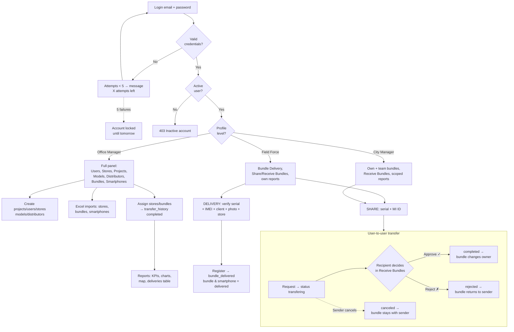
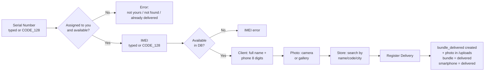
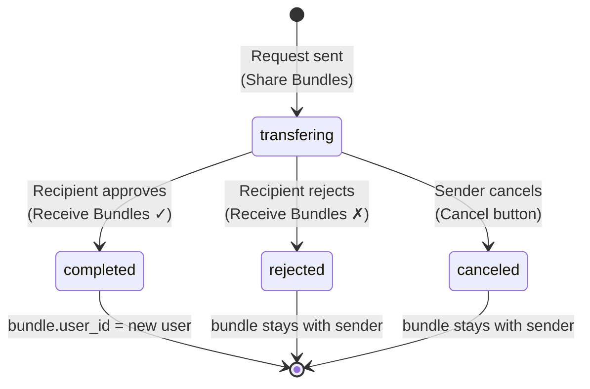

# BundleSystem — User Workflow

Guide to system usage by role and process, with inputs and outputs for each flow.

## General Flow Diagram



## Bundle Delivery Diagram



## Transfer Status Diagram



## Roles

| Level | Main access |
|---|---|
| **Office Manager** | Everything: users, stores, projects, models, distributors, bundles, smartphones, reports |
| **City Manager** | Own and team bundles, transfer receiving, filtered reports |
| **Field Force** | Bundle delivery, share/receive bundles, own reports |

---

## 1. Authentication

**Flow:** Login → validation → active session

| Step | Input | Output |
|---|---|---|
| Enter credentials | Email + password | Session started / error |
| Wrong password | Invalid credentials | "X attempts left" |
| 5 failures | — | Account locked until tomorrow 00:00 |
| Inactive user | Any request | 403 → session closed |

---

## 2. Office Manager Flows

### 2.1 Create Project (Projects → Create Project)
- **Input:** `project_name`, `start_date`, `status`
- **Output:** Project in table / success message

### 2.2 Create/Edit User (Users → Create User)
- **Input:** `mi_id`, `email`, `password`, `level`, first/last name, role title, date of birth, city, head in charge, photo
- **Output:** User in table with circular photo, status badge (green/red)
- **Extra:** Delete inside the edit form (confirmation modal)

### 2.3 Create Store (Stores → Create a Store)
- **Input:** `store_code`, `store_name`, `city`
- **Output:** Store automatically assigned to the session user

### 2.4 Assign Store (Stores → assign icon)
- **Input:** User search (name/MI ID/email) → selection
- **Output:** `stores.user_id` updated + confirmation

### 2.5 Import Stores Excel (Stores → Create Store from Excel)
- **Input:** Excel with columns `Code, Name, MI ID, City`
- **Output:** Stores created assigned by MI ID; per-row error report

### 2.6 Reassign Stores Excel (Stores → Reassign Store from Excel)
- **Input:** Excel with `Code, MI ID`
- **Output:** `stores.user_id` reassigned in bulk; per-row errors

### 2.7 Create Bundle Model / Smartphone Model / Distributor
- **Input:** Forms with each table's fields (`bundle_name`; `product_id, model_name, sku_name, ram, rom, color`; `distributor_name`)
- **Output:** Record in its listing table

### 2.8 Create/Import Bundle (Bundles → Add Bundle / Import from Excel)
- **Manual input:** `serial_number`, `project`, `bundle_model`
- **Excel input:** `Serial Number, Project, Bundle Model` (template with dropdowns)
- **Output:** `available` bundles automatically assigned to the importing user

### 2.9 Import Smartphones (Smartphones → Import Excel)
- **Input:** Excel with `IMEI 1, Product ID, Distributor` (template with dropdowns)
- **Output:** `available` smartphones; `tag_model` = first 8 IMEI digits; per-row errors

### 2.10 Direct Bundle Assignment (Bundles → assign icon)
- **Input:** Verified serial + target user (search box)
- **Output:** `bundle.user_id` changed + `transfer_history` with `status: completed`, `manager_user_id` of the person making the change

---

## 3. Bundle Delivery Flow (Field Force)

**Flow:** Bundle Delivery → verify bundle + smartphone + client + store → register

| Step | Input | Output |
|---|---|---|
| Verify serial | Serial typed or scanned (CODE_128) | "Verified: model" / error (not yours, not found, already delivered) |
| Verify IMEI | IMEI typed or scanned | "Verified: model — distributor" / error |
| Client data | `client_full_name`, `client_phone` (8 digits, +591) | Validation |
| Photo | Device camera or gallery | Preview |
| Store | Search by name/code/city | Selected store with code |
| **Register** | — | `bundle_delivered` created; bundle and smartphone → `delivered` |

---

## 4. User-to-User Transfer Flow (Share / Receive)

**Flow:** Sender requests → `transfering` → recipient approves/rejects (or sender cancels)

### 4.1 Share Bundle (sending)
- **Input:** Serial of own bundle (typed or scanned) + target MI ID (typed or scanned from a barcode)
- **Output:** `transfer_history` with `status: 'transfering'` — the bundle **stays yours** until approved
- **MI ID verification:** shows the recipient's name/level automatically

### 4.2 Bundles in Transfer (my pending outgoing)
- **Output:** List of sent serials pending, with recipient and date
- **Action:** **Cancel** button → confirmation modal → `status: 'canceled'` (bundle stays yours)

### 4.3 Receive Bundles (approval — all levels)
- **Input:** ✓ (approve) or ✗ (reject) button on each pending transfer + confirmation modal
- **Approve →** `bundle.user_id` moves to the new user + `status: 'completed'`
- **Reject →** `status: 'rejected'` + bundle returns to sender

### 4.4 My Code (sharing MI ID)
- **Output:** Modal with a **CODE_128** barcode of your MI ID so others can scan it

### `transfer_history` status cycle
```
transfering ──(recipient approves)──► completed  (bundle transferred)
           ──(recipient rejects)───► rejected   (bundle returns to sender)
           ──(sender cancels)──────► canceled   (bundle stays with sender)
```

---

## 5. Reports

| Element | Who sees it | Data |
|---|---|---|
| KPIs | Everyone (per scope) | Bundles, available, delivered, stores, projects |
| Bundles by user / Profiles / Map / By user | Office + City Manager | Charts |
| Deliveries by Store / Day | Everyone | Only their scope |
| Deliveries table | Everyone | Client, Store, User*, SN, IMEI, City*, Photo, Date — with per-column filters (*hidden for Field Force) |

- **Scope:** Office Manager = everything; City Manager = self + team (`head_in_charge`); Field Force = own only
- **Client detail:** click the name → modal with the full delivery data

---

## 6. Cross-cutting Behavior

- **Session blocking:** inactive user → 403 → automatic logout and redirect to login
- **`x-user-id`:** sent on every request → identifies who performs each action (`manager_user_id`)
- **CODE_128 scanner:** available on delivery serial/IMEI, share serial/MI ID, and serial search in Bundles
- **Search boxes:** per-column magnifying-glass filters in Stores, Bundles, Smartphones and the deliveries table; user/store search with filterable list in assignments
