# BundleSystem — GUI (Interfaz Gráfica de Usuario)

Catálogo visual de cada pantalla del sistema con capturas reales, su propósito y los elementos interactivos.

> Capturas tomadas a 1440×900 con sesiones reales de Office Manager y Field Force.

---

## 1. Login

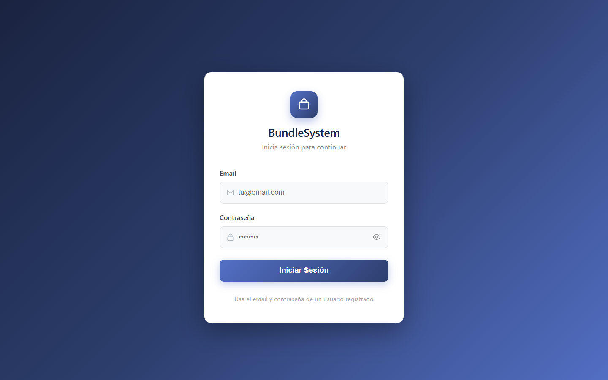

**Propósito:** autenticar al usuario con email y contraseña.

- **Inputs:** email, contraseña (con ojito para mostrar/ocultar)
- **Feedback:** "Te quedan X intentos" tras fallo; bloqueo de cuenta a los 5 intentos
- **Output:** sesión guardada en `localStorage` → acceso al dashboard

---

## 2. Reportes (vista inicial)

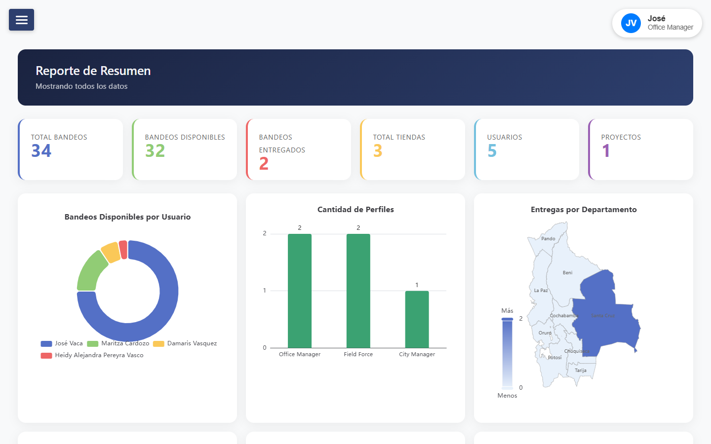

**Propósito:** dashboard con KPIs, gráficas y tabla de entregas registradas.

- **KPIs:** Bandeos, Disponibles, Entregados, Tiendas, Proyectos (según nivel)
- **Gráficas:** Bandeos por usuario, Entregas por tienda/día, mapa de Bolivia por departamento
- **Tabla Entregas:** Cliente, Tienda, Usuario, SN, IMEI, Ciudad, Foto, Fecha — con filtros por columna (lupa) y filtro de fecha (calendario)

---

## 3. Usuarios *(Office Manager)*

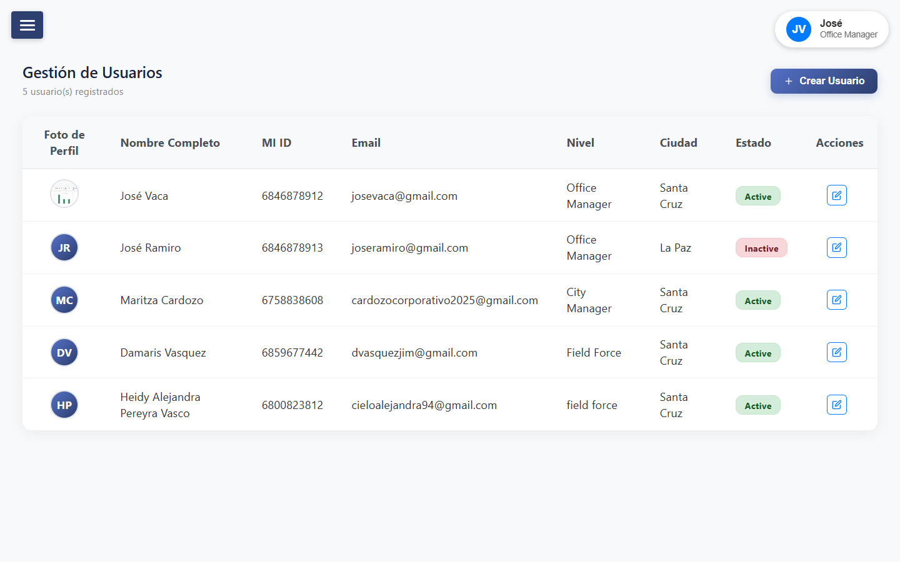

**Propósito:** administrar cuentas del sistema.

- Tabla con foto circular, nombre, MI ID, nivel, estado (badge verde/rojo)
- Botón **Crear Usuario**, editar y eliminar con modal de confirmación

---

## 4. Tiendas *(Office Manager)*

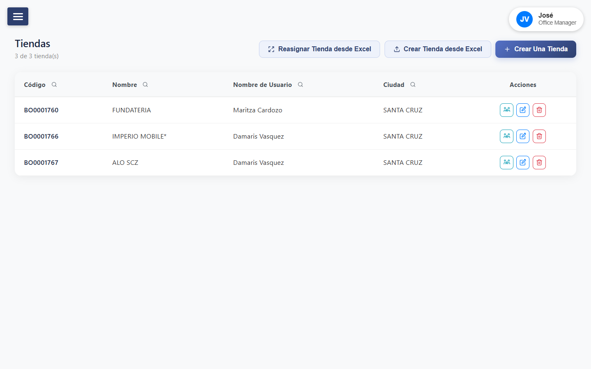

**Propósito:** gestionar tiendas y su asignación a usuarios.

- Tabla con código, nombre, ciudad y propietario
- Crear una tienda, importar desde Excel, reasignar masivo, asignar individualmente (buscador)

---

## 5. Proyectos *(Office Manager)*

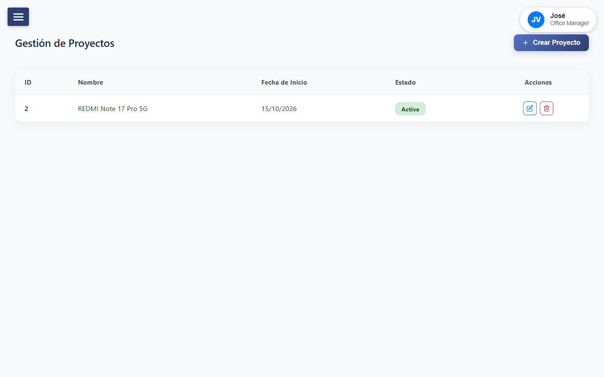

**Propósito:** crear y administrar proyectos de bandeo.

- Campos: nombre, fecha de inicio, estado
- Editar y eliminar con confirmación

---

## 6. Modelos de Bandeo *(Office Manager)*

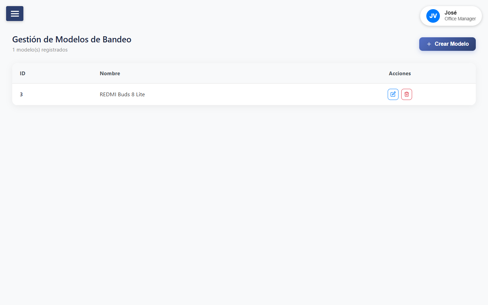

**Propósito:** catálogo de modelos de auriculares/bandeos.

- CRUD de `bundle_model` con colores asociados

---

## 7. Bandeos

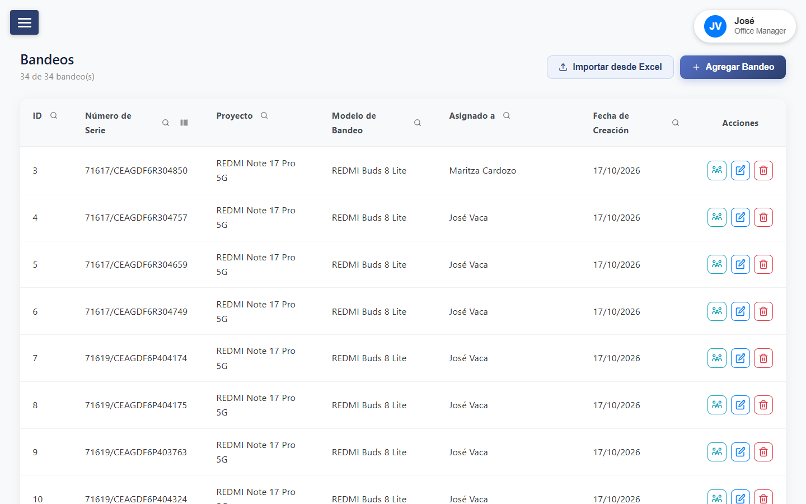

**Propósito:** inventario de bandeos con asignación.

- Columnas: ID, Número de Serie, Proyecto, Modelo, Asignado a, Fecha de Creación
- **Filtros por columna** (lupa) + **escáner CODE_128** en Número de Serie
- Acciones: asignar a usuario, editar, eliminar
- **Importar desde Excel** (plantilla con desplegables) y **Agregar Bandeo** manual
- *City Manager ve solo los suyos y los de su equipo*

---

## 8. Modelos de Smartphone *(Office Manager)*

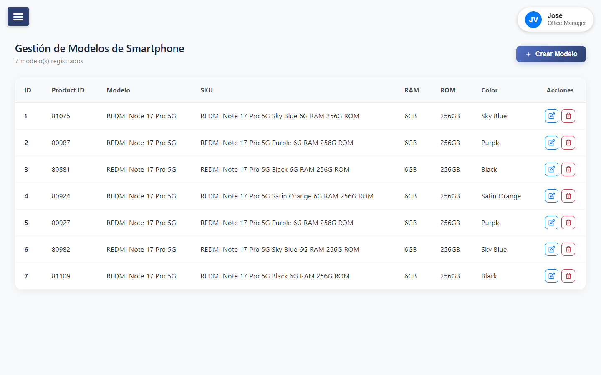

**Propósito:** catálogo de modelos de celulares (Product ID, modelo, SKU, RAM, ROM, color).

---

## 9. Smartphones *(Office Manager)*

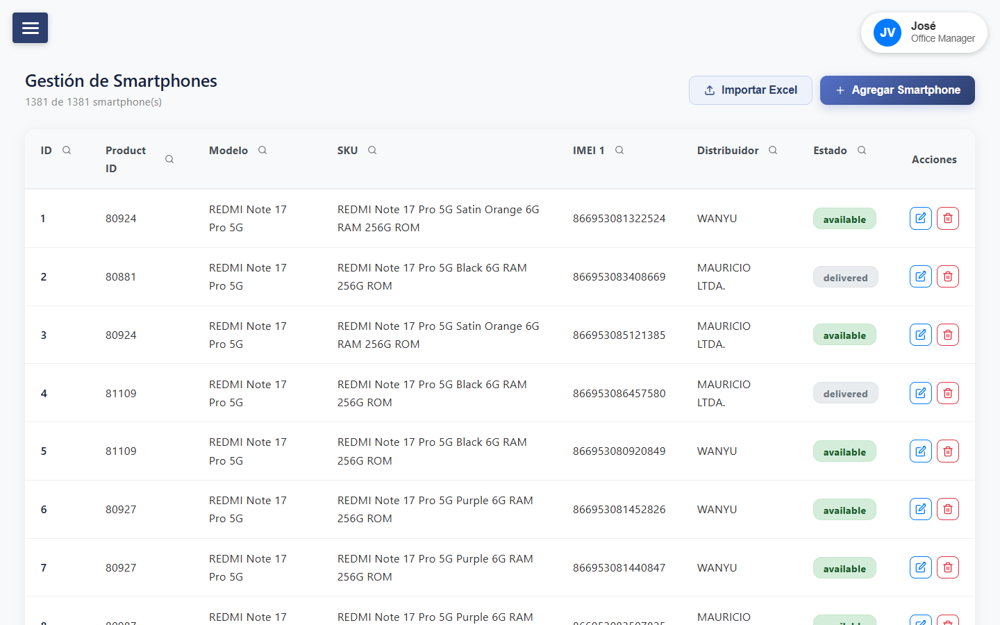

**Propósito:** inventario de celulares por IMEI.

- Columnas: ID, Product ID, Modelo, SKU, IMEI 1, Distribuidor, Estado
- Estado `delivered` en badge gris, `available` en verde
- **Importar desde Excel** con plantilla de desplegables
- Filtros por columna (lupa)

---

## 10. Distribuidores *(Office Manager)*

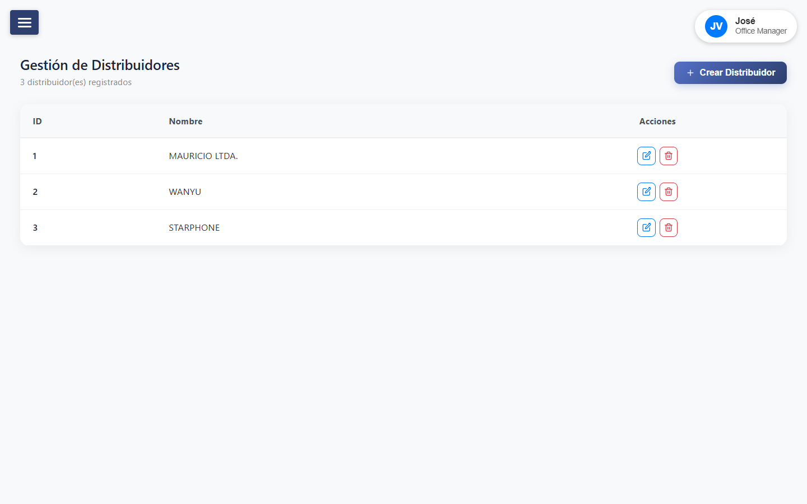

**Propósito:** gestionar distribuidores de smartphones.

- Tabla con ID y nombre; crear, editar, eliminar con confirmación

---

## 11. Recibir Bandeos *(todos los niveles)*

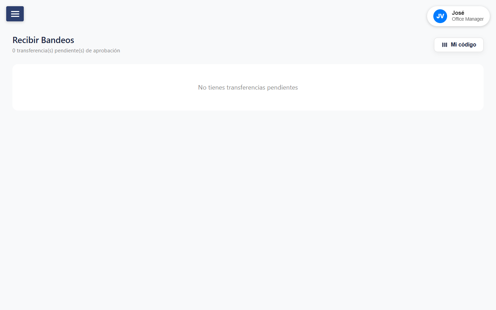

**Propósito:** aprobar o rechazar transferencias pendientes dirigidas al usuario.

- Tarjetas con serial, modelo, emisor y fecha
- Botón **✓ azul** (aprobar → `completed`) y **✗ roja** (rechazar → `rejected`) — ambos con modal de confirmación
- Botón **"Mi Código"**: modal con código de barras CODE_128 del MI ID propio

---

## 12. Reportes — Field Force

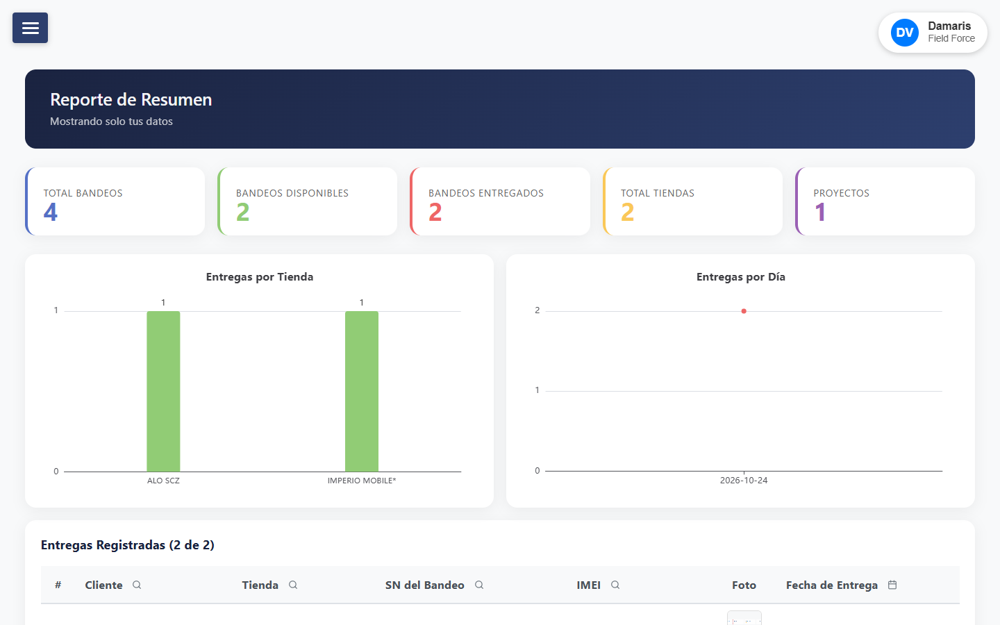

**Propósito:** dashboard limitado a los datos propios del Field Force.

- KPIs (incluye Bandeos Disponibles) + Entregas por Tienda y por Día
- **Ocultas:** Bandeos por Usuario, Entregas por Departamento, Entregas por Usuario, Perfiles
- Tabla de entregas sin columnas Usuario ni Ciudad

---

## 13. Entrega de Bandeos *(Field Force)*

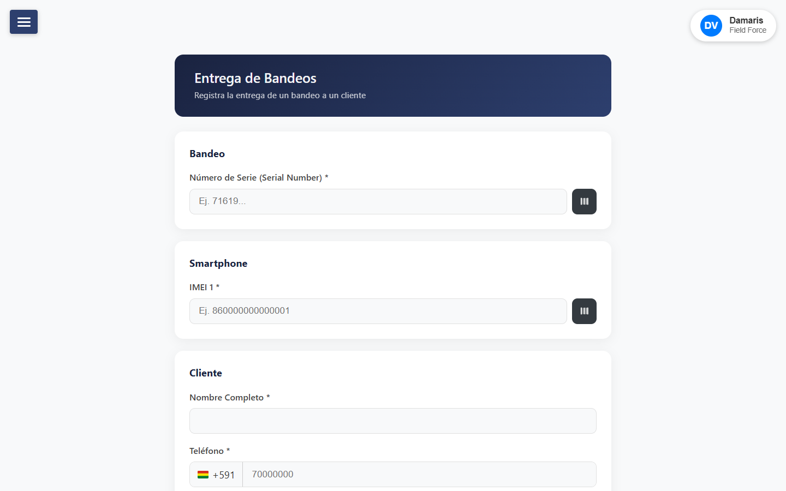

**Propósito:** registrar la entrega de un bandeo + smartphone a un cliente.

- **Inputs:** serial (escrito o escaneado CODE_128), IMEI, nombre del cliente, teléfono, foto (cámara/galería), tienda (buscador filtrable)
- Verificación automática de serial e IMEI al escribir
- **Output:** `bundle_delivered` + ambos ítems pasan a `delivered`

---

## 14. Compartir Bandeos *(Field Force)*

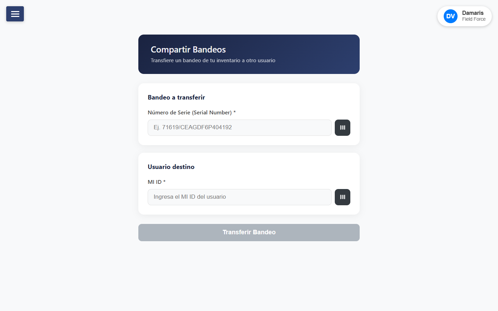

**Propósito:** solicitar transferencia de un bandeo propio a otro usuario por MI ID.

- Serial propio (escrito o escaneado) + MI ID destino con verificación automática
- **Bandeos en transferencia:** lista de solicitudes enviadas con botón Cancelar (modal → `canceled`)
- El bandeo permanece del emisor hasta que el destinatario apruebe

---

## 15. Recibir Bandeos — Field Force

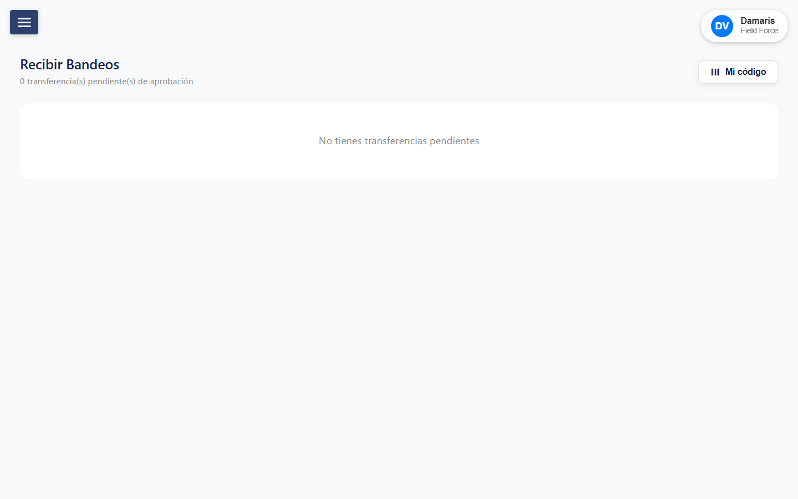

Misma página que el punto 11 — visible para todos los niveles, cada usuario solo ve las transferencias dirigidas a él.
