# BundleSystem — GUI (Graphical User Interface)

Visual catalog of every screen in the system with real screenshots, their purpose and interactive elements.

> Screenshots taken at 1440×900 with real Office Manager and Field Force sessions. The application UI is in Spanish; descriptions below are in English.

---

## 1. Login

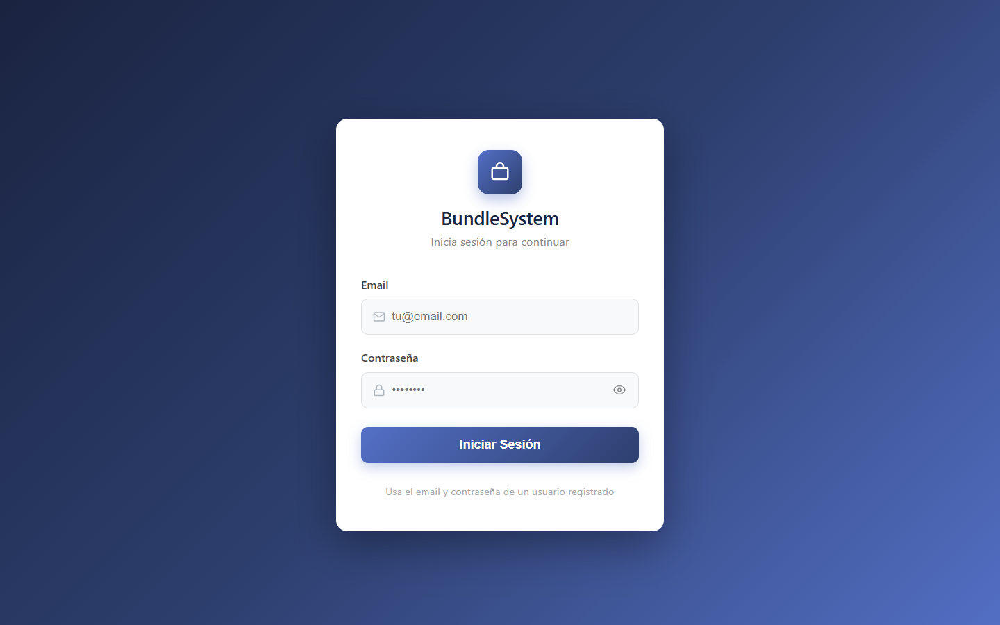

**Purpose:** authenticate the user with email and password.

- **Inputs:** email, password (with eye icon to show/hide)
- **Feedback:** "X attempts left" after a failure; account lockout after 5 attempts
- **Output:** session stored in `localStorage` → access to the dashboard

---

## 2. Reports (home view)

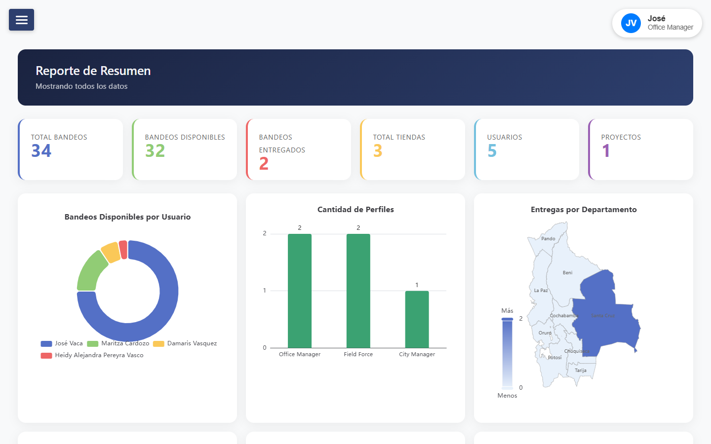

**Purpose:** dashboard with KPIs, charts and the registered deliveries table.

- **KPIs:** Bundles, Available, Delivered, Stores, Projects (per level)
- **Charts:** Bundles by user, Deliveries by store/day, Bolivia map by department
- **Deliveries table:** Client, Store, User, SN, IMEI, City, Photo, Date — with per-column filters (magnifier) and date filter (calendar)

---

## 3. Users *(Office Manager)*

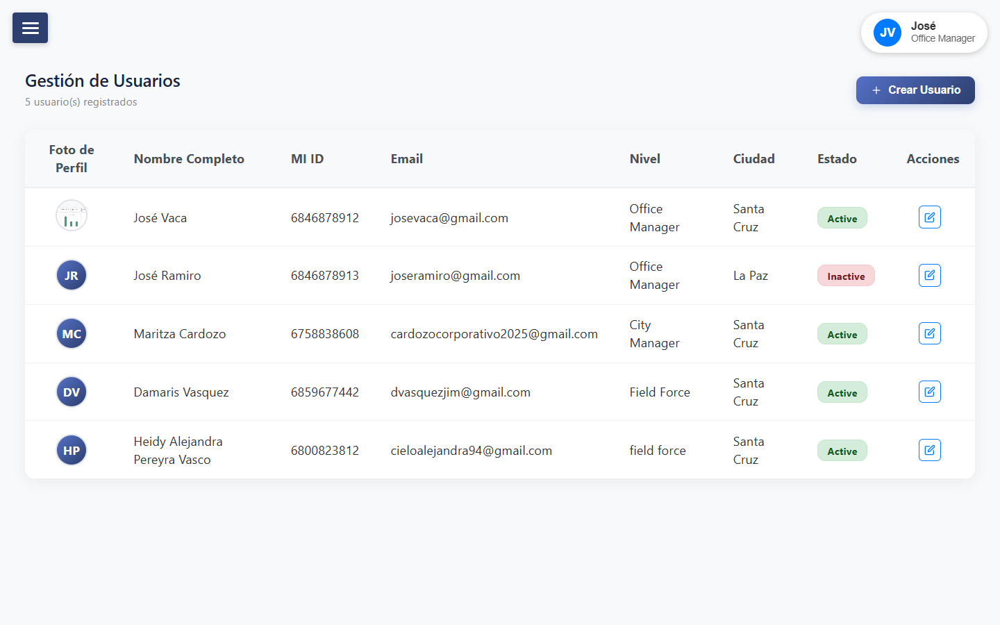

**Purpose:** manage system accounts.

- Table with circular photo, name, MI ID, level, status (green/red badge)
- **Create User** button, edit and delete with confirmation modal

---

## 4. Stores *(Office Manager)*

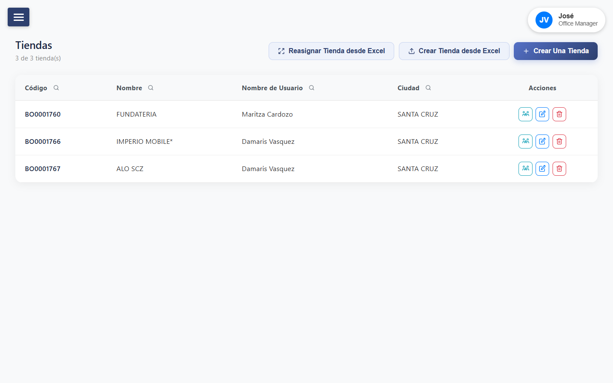

**Purpose:** manage stores and their assignment to users.

- Table with code, name, city and owner
- Create a store, import from Excel, batch reassign, assign individually (search box)

---

## 5. Projects *(Office Manager)*

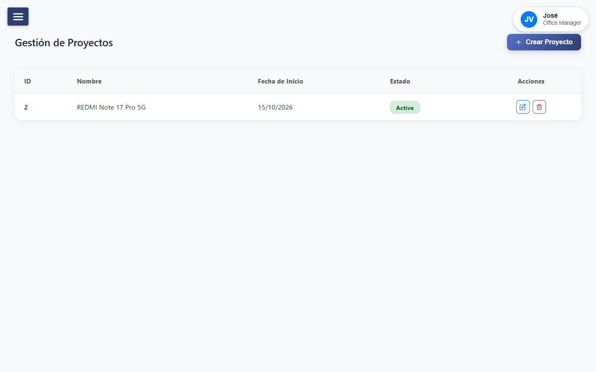

**Purpose:** create and manage bundling projects.

- Fields: name, start date, status
- Edit and delete with confirmation

---

## 6. Bundle Models *(Office Manager)*

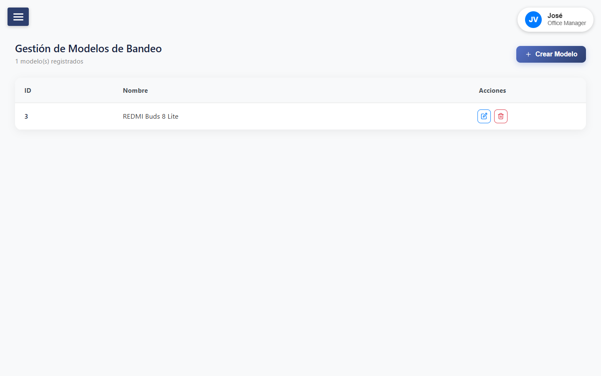

**Purpose:** catalog of headphone/bundle models.

- `bundle_model` CRUD with associated colors

---

## 7. Bundles

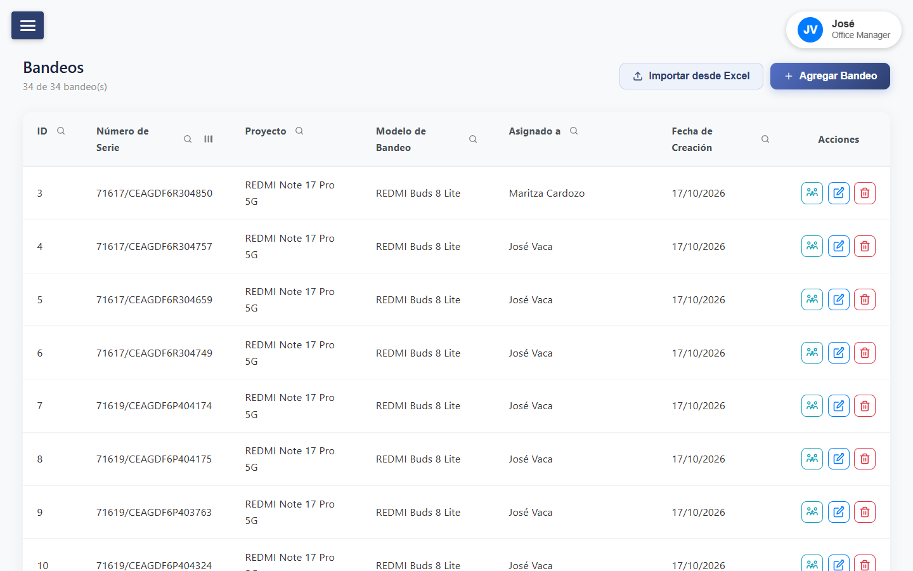

**Purpose:** bundle inventory with assignment.

- Columns: ID, Serial Number, Project, Model, Assigned to, Creation Date
- **Per-column filters** (magnifier) + **CODE_128 scanner** on Serial Number
- Actions: assign to user, edit, delete
- **Import from Excel** (template with dropdowns) and manual **Add Bundle**
- *City Manager only sees their own and their team's*

---

## 8. Smartphone Models *(Office Manager)*

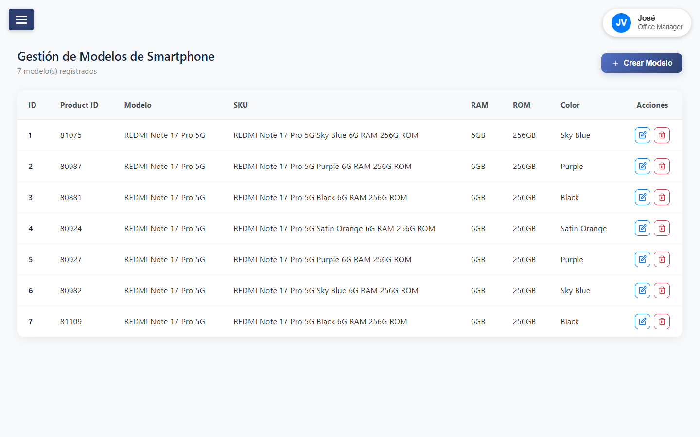

**Purpose:** catalog of smartphone models (Product ID, model, SKU, RAM, ROM, color).

---

## 9. Smartphones *(Office Manager)*

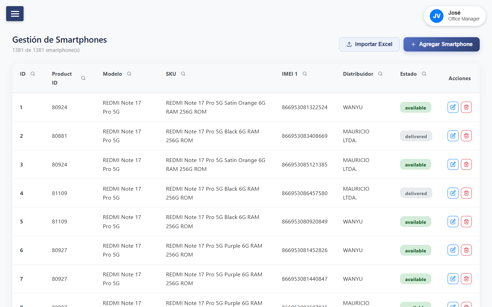

**Purpose:** smartphone inventory by IMEI.

- Columns: ID, Product ID, Model, SKU, IMEI 1, Distributor, Status
- `delivered` status in gray badge, `available` in green
- **Import from Excel** with dropdown template
- Per-column filters (magnifier)

---

## 10. Distributors *(Office Manager)*

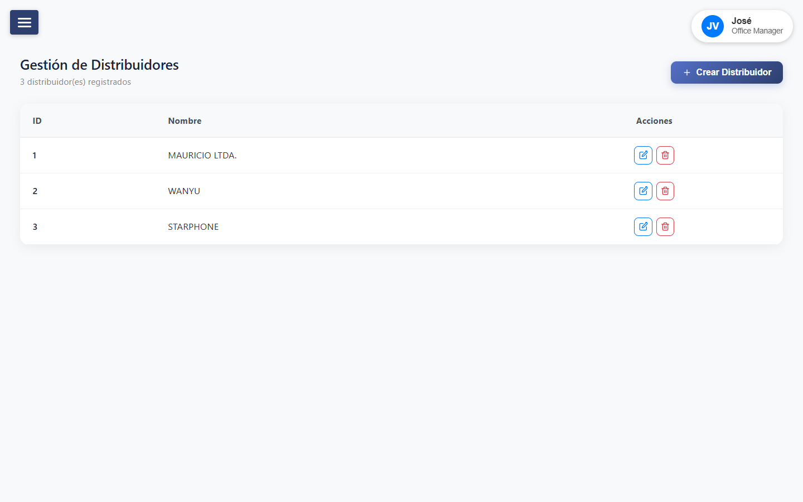

**Purpose:** manage smartphone distributors.

- Table with ID and name; create, edit, delete with confirmation

---

## 11. Receive Bundles *(all levels)*

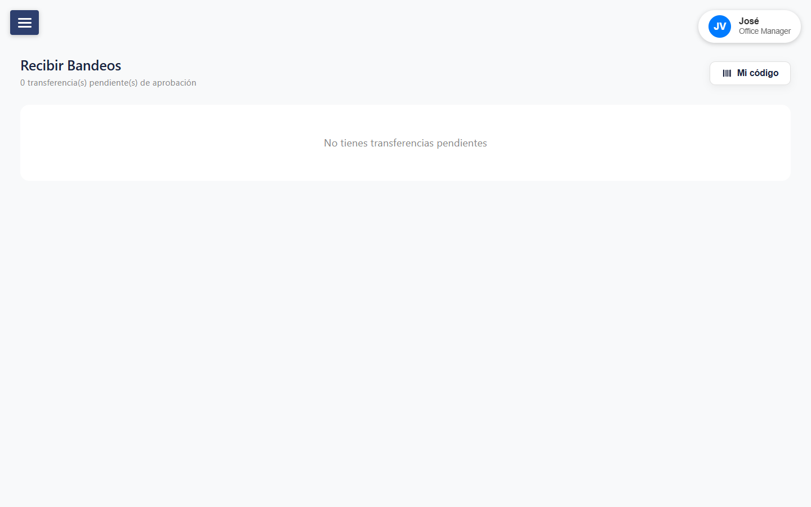

**Purpose:** approve or reject pending transfers addressed to the user.

- Cards with serial, model, sender and date
- **Blue ✓** button (approve → `completed`) and **red ✗** (reject → `rejected`) — both with confirmation modal
- **"Mi Código" button:** modal with a CODE_128 barcode of your own MI ID

---

## 12. Reports — Field Force

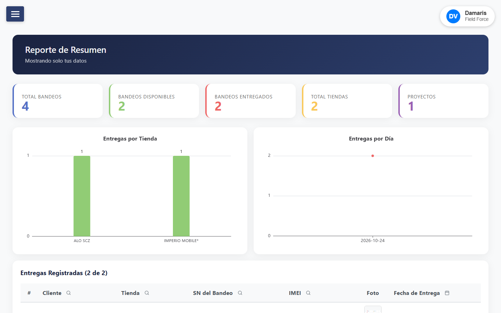

**Purpose:** dashboard limited to the Field Force user's own data.

- KPIs (including Available Bundles) + Deliveries by Store and by Day
- **Hidden:** Bundles by User, Deliveries by Department, Deliveries by User, Profiles
- Deliveries table without User and City columns

---

## 13. Bundle Delivery *(Field Force)*

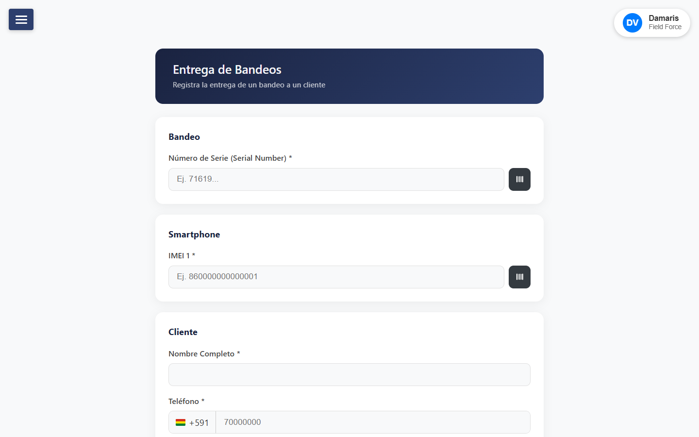

**Purpose:** register the delivery of a bundle + smartphone to a client.

- **Inputs:** serial (typed or CODE_128 scanned), IMEI, client name, phone, photo (camera/gallery), store (filterable search box)
- Automatic serial and IMEI verification while typing
- **Output:** `bundle_delivered` + both items change to `delivered`

---

## 14. Share Bundles *(Field Force)*

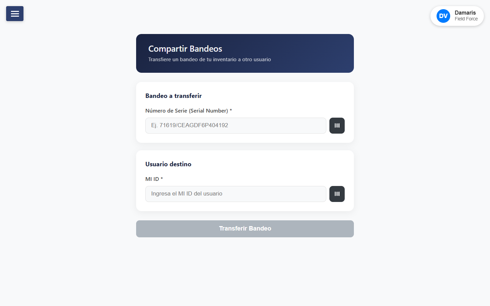

**Purpose:** request the transfer of an owned bundle to another user by MI ID.

- Own serial (typed or scanned) + target MI ID with automatic verification
- **Bundles in transfer:** list of sent requests with Cancel button (modal → `canceled`)
- The bundle stays with the sender until the recipient approves

---

## 15. Receive Bundles — Field Force

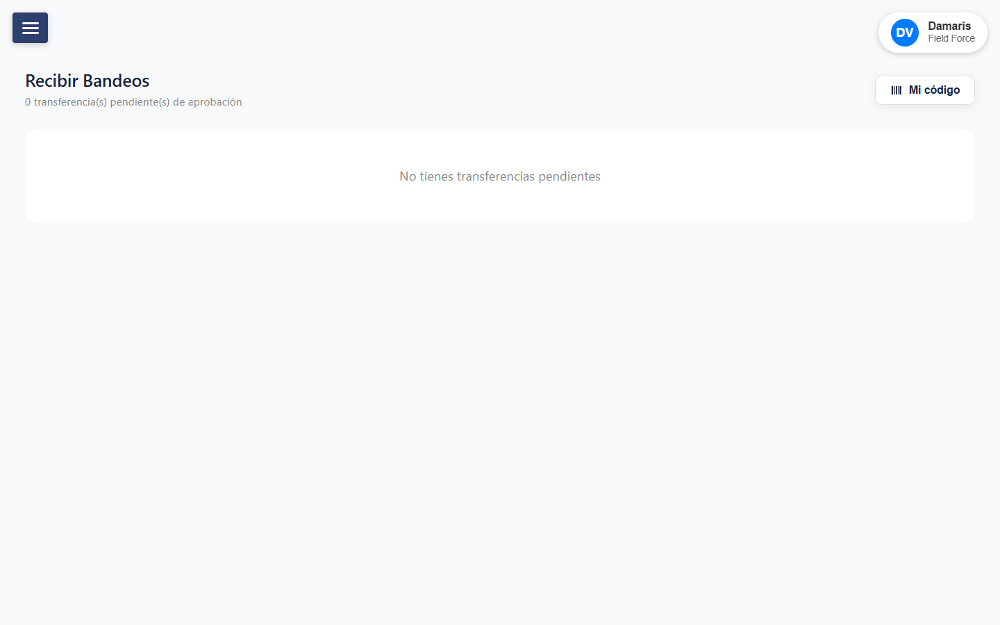

Same page as point 11 — visible to all levels; each user only sees the transfers addressed to them.
